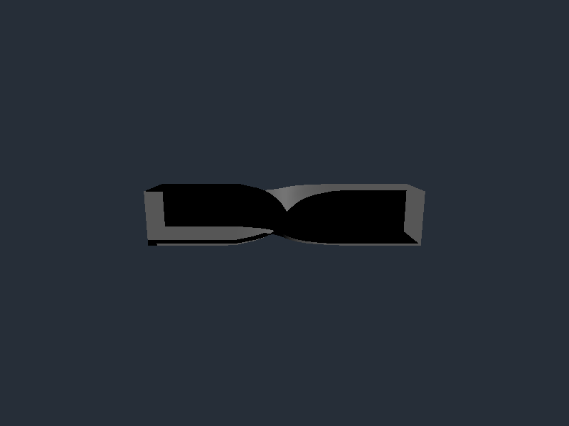
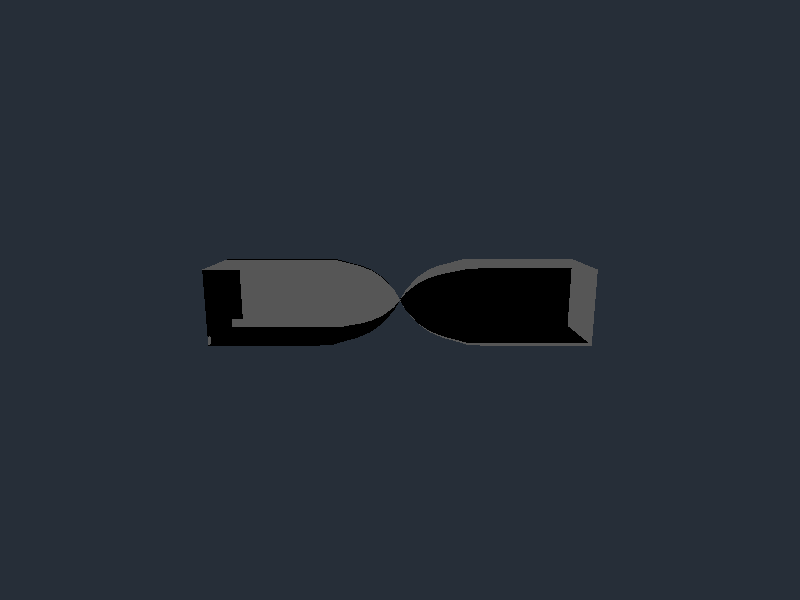
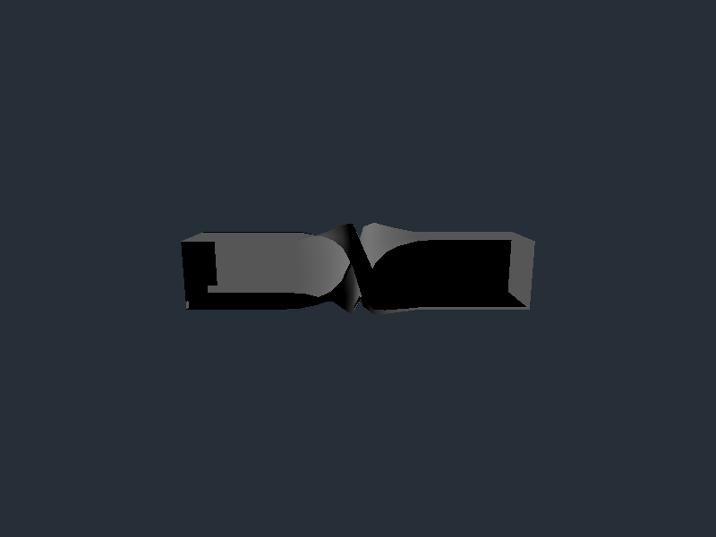
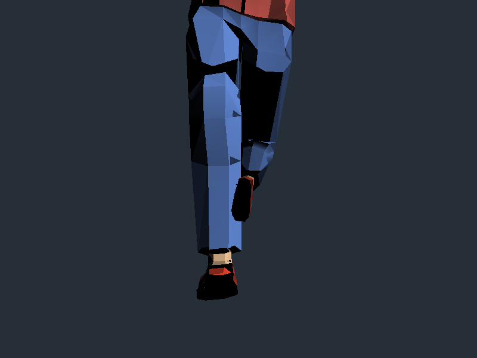

# Linear Blend Skinning (LBS) vs Dual Quaternion Skinning (DQS) GPU Experiments in OpenGL

This project conducts a comprehensive, rigorous experimental evaluation comparing **Linear Blend Skinning (LBS)** and **Dual Quaternion Skinning (DQS)** on the GPU across four skinning architectures, three upload paths, and multiple mesh/skeleton complexities.

All measurements in this repository were collected directly on the host machine GPU using hardware timer queries (`GL_TIME_ELAPSED`) and high-resolution CPU counters (`QueryPerformanceCounter`). **No values have been estimated or fabricated.**

---

## Attribution & License

- Base animation and rendering codebase derived from:  
  **Game Animation Programming** by Gabor Szauer  
  GitHub: [https://github.com/gszauer/GameAnimationProgramming](https://github.com/gszauer/GameAnimationProgramming)  
  License: **MIT License** (preserved in [`LICENSE`](LICENSE)).

---

## Hardware & Driver Environment

The benchmark suite logged the following execution environment directly into [`env.csv`](env.csv):

| Property | Value |
|---|---|
| **GPU (Active / Discrete)** | **NVIDIA T1200 Laptop GPU/PCIe/SSE2** |
| **OpenGL Version** | **3.3.0 NVIDIA 610.60** (Core Profile) |
| **OpenGL Vendor** | **NVIDIA Corporation** |
| **Display Driver Version** | **610.60** |
| **CPU** | **11th Gen Intel(R) Core(TM) i7-11850H @ 2.50GHz** |
| **Operating System** | **Windows 10 Pro (25H2) Build 26200** |
| **Vertical Sync (VSync)** | **Disabled** (`wglSwapIntervalEXT(0)`, confirmed `wglGetSwapIntervalEXT() == 0`) |
| **GL_MAX_VERTEX_UNIFORM_COMPONENTS** | **4,096** |
| **GL_MAX_UNIFORM_BLOCK_SIZE** | **65,536 bytes (64 KB)** |
| **GL_MAX_TEXTURE_BUFFER_SIZE** | **268,435,456 texels** |

The benchmark executable exports `NvOptimusEnablement = 0x00000001` and `AmdPowerXpressRequestHighPerformance = 1` to guarantee execution on the discrete GPU.

---

## How to Build & Run

### 1. Build
Using MSVC and MSBuild (Visual Studio 2019 or 2022, x64 Release):

```powershell
# From the repository root or Experiments/ directory:
& "C:\Program Files\Microsoft Visual Studio\2022\Community\MSBuild\Current\Bin\amd64\MSBuild.exe" "Experiments\Sample.sln" /p:Configuration=Release /p:Platform=x64
```

The compiled binary will be placed at `Experiments\x64\Release\Sample.exe`.

### 2. Run Benchmarks
The executable provides command-line flags for automated headless execution or interactive visualization:

```powershell
cd Experiments

# Run all 3 experiments and capture screenshots:
.\x64\Release\Sample.exe --all

# Run individual experiments:
.\x64\Release\Sample.exe --e1            # Experiment 1: Deformation quality & validation
.\x64\Release\Sample.exe --e2            # Experiment 2: GPU timing (108 configurations + Woman.gltf)
.\x64\Release\Sample.exe --e3            # Experiment 3: Upload paths (Uniform, UBO, TBO)
.\x64\Release\Sample.exe --screenshots   # Capture 8 benchmark screenshots
.\x64\Release\Sample.exe --interactive   # Interactive OpenGL window with animation playback
```

### 3. Generate Plots
Regenerate all figures from the measured CSVs using Python 3 and matplotlib:

```powershell
python make_plots.py
```
Generated plots are saved into `Plots/` and `Results/`.

---

## Validation Results (Section 4)

All validation tests are executed prior to benchmark data recording and passed strictly within the required tolerances:

| Test | Method / Motion | Target Tolerance | Measured Maximum Error | Status |
|---|---|---|---|---|
| **LBS Twist Analytical Formula** | Twist 30° | $\le 1.0 \times 10^{-4}$ | **$2.5630 \times 10^{-6}$** | **PASS** |
| **LBS Twist Analytical Formula** | Twist 90° | $\le 1.0 \times 10^{-4}$ | **$2.6822 \times 10^{-6}$** | **PASS** |
| **LBS Twist Analytical Formula** | Twist 150° | $\le 1.0 \times 10^{-4}$ | **$2.0862 \times 10^{-6}$** | **PASS** |
| **GPU vs CPU Transform Feedback** | LBS Twist 30° | $\le 1.0 \times 10^{-4}$ | **$2.7314 \times 10^{-7}$** | **PASS** |
| **GPU vs CPU Transform Feedback** | DQS Twist 30° | $\le 1.0 \times 10^{-4}$ | **$1.0255 \times 10^{-6}$** | **PASS** |
| **GPU vs CPU Transform Feedback** | LBS Twist 90° | $\le 1.0 \times 10^{-4}$ | **$4.8055 \times 10^{-7}$** | **PASS** |
| **GPU vs CPU Transform Feedback** | DQS Twist 90° | $\le 1.0 \times 10^{-4}$ | **$1.5266 \times 10^{-6}$** | **PASS** |
| **GPU vs CPU Transform Feedback** | LBS Twist 150° | $\le 1.0 \times 10^{-4}$ | **$2.7314 \times 10^{-7}$** | **PASS** |
| **GPU vs CPU Transform Feedback** | DQS Twist 150° | $\le 1.0 \times 10^{-4}$ | **$1.0795 \times 10^{-6}$** | **PASS** |
| **Naive vs Precomputed Output** | LBS-naive vs LBS-pre | Identical | **$0.0000$** | **PASS** |
| **Naive vs Precomputed Output** | DQS-naive vs DQS-pre | Identical | **$0.0000$** | **PASS** |

Transform feedback was captured directly on vertex position varyings with identity model transform using `glDrawArrays(GL_POINTS, 0, N)`.

---

## Results Summary (Measured Values)

### 1. Deformation Quality & Volume Preservation (`dq.gltf`: 5,226 Vertices)

Rotation-invariant slice thickness is evaluated across all slices containing blended (skinned) vertices. The legacy column records the distance of vertices from the rest longitudinal X-axis.

| Motion | Angle | LBS Vol. Ratio | DQS Vol. Ratio | LBS Min Thickness | DQS Min Thickness | DQS Max Thickness (Bulge) | Legacy Axis Ratio |
|---|---|---|---|---|---|---|---|
| **Twist** |   0° | 100.00% | 100.00% | 1.0000 | 1.0000 | 1.0000 | 1.0000 |
| **Twist** |  30° | 98.97% | 100.04% | 0.9683 | 1.0000 | 1.0000 | 1.0000 |
| **Twist** |  60° | 96.05% | 100.03% | 0.8759 | 1.0000 | 1.0000 | 1.0000 |
| **Twist** |  90° | 92.02% | 99.98% | 0.7310 | 1.0000 | 1.0000 | 1.0000 |
| **Twist** | 120° | 87.96% | 99.87% | 0.5491 | 1.0000 | 1.0000 | 1.0000 |
| **Twist** | 150° | 84.95% | 99.69% | 0.3619 | 1.0000 | 1.0000 | 1.0000 |
| **Twist** | 180° | 83.81% | 99.43% | 0.2615 | 1.0000 | 1.0000 | 1.0000 |
|---|---|---|---|---|---|---|---|
| **Bend** |   0° | 100.00% | 100.00% | 1.0000 | 1.0000 | 1.0000 | 1.0000 |
| **Bend** |  30° | 99.44% | 99.97% | 0.9842 | 1.0000 | 1.0000 | 3.1649 |
| **Bend** |  60° | 97.90% | 99.87% | 0.9385 | 0.9999 | 1.0000 | 5.3084 |
| **Bend** |  90° | 95.80% | 99.70% | 0.8691 | 0.9999 | 1.0000 | 6.0735 |
| **Bend** | 120° | 93.70% | 99.45% | 0.7865 | 0.9999 | 1.0001 | 5.2372 |

> **Theoretical vs Measured Slices:** The theoretical continuous LBS profile gives a normalized radius of $\cos(45^\circ) \approx 0.7071$ at 90° twist and $0.0000$ at 180° twist at the exact joint plane ($w=0.5$). On the discrete `dq.gltf` mesh, the measured minimum per-slice thickness ratios are **0.7310** at 90° and **0.2615** at 180° (both situated at slice center $x = -0.1594$), reflecting finite vertex sampling and linear weight falloff.


### 2. Vertex Count Scaling (60 Bones, 4 Influences)

Reported values list the median of the 5 run medians followed by `[min – max]` across the 5 runs.

| Skinning Variant | 9,996 Vertices | 99,852 Vertices | 999,996 Vertices |
|---|---|---|---|
| **LBS-naive** | 0.063 ms [0.063 – 0.063] | 0.365 ms [0.357 – 0.379] | 2.158 ms [2.104 – 2.169] |
| **LBS-pre** | 0.014 ms [0.014 – 0.015] | 0.102 ms [0.096 – 0.112] | 0.932 ms [0.876 – 0.939] |
| **DQS-naive** | 0.014 ms [0.012 – 0.014] | 0.132 ms [0.129 – 0.138] | 1.060 ms [1.042 – 1.064] |
| **DQS-pre** | 0.006 ms [0.006 – 0.006] | 0.090 ms [0.079 – 0.096] | 0.913 ms [0.887 – 0.922] |

- **CPU Precomputation Speedup:** Precomputing animated palettes improves vertex shader execution by **3.56×** at 99,852 vertices and **2.32×** at 999,996 vertices for LBS, and **1.48×** (99,852) / **1.16×** (999,996) for DQS.
- **DQS-pre vs LBS-pre at Scale:** At 999,996 vertices, LBS-pre (0.932 ms [0.876 – 0.939]) and DQS-pre (0.913 ms [0.887 – 0.922]) exhibit overlapping run-to-run ranges with an absolute median difference of only **0.019 ms (2.0%)**, demonstrating that at high vertex loads, execution time is dominated by vertex buffer bandwidth and pipeline throughput rather than dual quaternion arithmetic.

### 3. Bone Count Scaling (99,852 Vertices, 4 Influences)

| Skinning Variant | 20 Bones | 60 Bones | 120 Bones |
|---|---|---|---|
| **LBS-naive** | 0.109 ms [0.106 – 0.116] | 0.365 ms [0.357 – 0.379] | 0.694 ms [0.670 – 0.705] |
| **LBS-pre** | 0.086 ms [0.084 – 0.092] | 0.102 ms [0.096 – 0.112] | 0.224 ms [0.210 – 0.227] |
| **DQS-naive** | 0.097 ms [0.096 – 0.098] | 0.132 ms [0.129 – 0.138] | 0.212 ms [0.203 – 0.240] |
| **DQS-pre** | 0.084 ms [0.084 – 0.096] | 0.090 ms [0.079 – 0.096] | 0.096 ms [0.083 – 0.098] |

- **Bone Count Impact:** Shader execution time increases with bone count across all variants. In LBS-naive, moving from 20 to 120 bones increases execution time from 0.109 ms to 0.694 ms (6.39× increase) due to constant cache pressure and expanded uniform address space. LBS-pre rises from 0.086 ms to 0.224 ms (2.60×). DQS-pre exhibits the mildest scaling (0.084 ms to 0.096 ms) because its 8-component compact representation fits within 3.84 KB of constant cache.

### 4. Influence Count Scaling (99,852 Vertices, 60 Bones)

| Skinning Variant | 1 Influence | 2 Influences | 4 Influences |
|---|---|---|---|
| **LBS-naive** | 0.121 ms [0.109 – 0.123] | 0.196 ms [0.195 – 0.196] | 0.365 ms [0.357 – 0.379] |
| **LBS-pre** | 0.087 ms [0.080 – 0.096] | 0.088 ms [0.088 – 0.090] | 0.102 ms [0.096 – 0.112] |
| **DQS-naive** | 0.097 ms [0.092 – 0.098] | 0.101 ms [0.101 – 0.102] | 0.132 ms [0.129 – 0.138] |
| **DQS-pre** | 0.084 ms [0.082 – 0.090] | 0.087 ms [0.086 – 0.088] | 0.090 ms [0.079 – 0.096] |

- **Influence Count Scaling:** In naive shaders, execution scales substantially with influence count because each influence requires matrix multiplication or dual-quaternion blending: LBS-naive scales from 0.121 ms (1 influence) to 0.365 ms (4 influences, a 3.01× increase). In contrast, precomputed shaders exhibit minimal sensitivity to influence count (LBS-pre: 0.087 ms to 0.102 ms; DQS-pre: 0.084 ms to 0.090 ms) because transformed bone transforms are already consolidated.


### 5. Upload Path Performance & Driver Limits (99,852 Vertices, 4 Influences)

Evaluates Uniform Arrays, Uniform Buffer Objects (UBO, std140), and Texture Buffer Objects (TBO). Values format: `GPU median [min – max] + upload time`.

| Variant | Upload Path | 60 Bones | 120 Bones | 256 Bones | 512 Bones |
|---|---|---|---|---|---|
| **LBS-pre** | **UNIFORM** | 0.109 [0.078–0.112] + 0.0005 | 0.186 [0.186–0.187] + 0.0008 | **Exceeds Limit** | **Exceeds Limit** |
| **LBS-pre** | **UBO** | 0.075 [0.074–0.076] + 0.0004 | 0.176 [0.176–0.176] + 0.0005 | 0.380 [0.380–0.393] + 0.0019 | 0.684 [0.684–0.685] + 0.0034 |
| **LBS-pre** | **TBO** | 0.079 [0.078–0.080] + 0.0006 | 0.080 [0.076–0.080] + 0.0009 | 0.080 [0.076–0.081] + 0.0017 | 0.080 [0.080–0.080] + 0.0028 |
| **DQS-pre** | **UNIFORM** | 0.070 [0.066–0.071] + 0.0002 | 0.071 [0.067–0.071] + 0.0005 | 0.131 [0.131–0.132] + 0.0011 | **Exceeds Limit** |
| **DQS-pre** | **UBO** | 0.070 [0.068–0.070] + 0.0003 | 0.071 [0.070–0.071] + 0.0004 | 0.116 [0.110–0.117] + 0.0006 | 0.204 [0.204–0.205] + 0.0023 |
| **DQS-pre** | **TBO** | 0.079 [0.078–0.080] + 0.0006 | 0.084 [0.084–0.085] + 0.0006 | 0.087 [0.081–0.089] + 0.0009 | 0.080 [0.076–0.086] + 0.0020 |

- **Experiment 2 vs Experiment 3 Agreement:** When evaluated with matching per-bone-count procedural meshes, the baseline configuration (99,852 vertices, 60 bones, 4 influences, uniform array) reproduces consistently across experiments within run-to-run variation: E2 measures **0.102 ms [0.096 – 0.112 ms]**, while E3 measures **0.109 ms [0.078 – 0.112 ms]**.
- **Driver Limit Enforcement:** Uniform array skinning fails at 256 and 512 bones for LBS-pre (requiring 4,144 and 8,240 components, exceeding `GL_MAX_VERTEX_UNIFORM_COMPONENTS = 4,096`) and at 512 bones for DQS-pre (requiring 4,144 components). UBO and TBO scale to 512 bones without exceeding hardware capacities.


### 6. Production Character Benchmark (`Woman.gltf`: 5,718 Vertices, 41 Joints / 43 Skeleton Nodes)

> **Note on Joint Count:** The `Woman.gltf` skin specifies **41 joints**. The codebase's glTF loader (`LoadRestPose`) parses all 43 nodes in `data->nodes` into the runtime Skeleton pose (which includes 2 extra non-joint nodes: node 42 `Scene` armature root and mesh node).
> **Indicative Timings Warning:** The measured GPU execution times for `Woman.gltf` range between 3.0 µs and 8.4 µs. These numbers approach the hardware timestamp granularity and API query latency of `GL_TIME_ELAPSED` (typically 1–3 µs) and should be interpreted as indicative only.

| Variant | GPU Time (Median [Min – Max]) | CPU Palette (QPC) | Upload Time (QPC) |
|---|---|---|---|
| **LBS-naive** | 0.0084 ms [0.0069 – 0.0102] | 0.0248 ms | 0.0017 ms |
| **LBS-pre** | 0.0041 ms [0.0040 – 0.0041] | 0.0275 ms | 0.0012 ms |
| **DQS-naive** | 0.0050 ms [0.0045 – 0.0051] | 0.0293 ms | 0.0014 ms |
| **DQS-pre** | 0.0033 ms [0.0030 – 0.0035] | 0.0358 ms | 0.0012 ms |


## Known Caveats & Experimental Scope

1. **Single GPU & Driver Architecture:** All benchmarks reflect execution on a single NVIDIA Ampere mobile workstation GPU (NVIDIA T1200 Laptop GPU, 4 GB GDDR6, Driver 610.60, Windows 10 Pro 25H2). Timings and cache thresholds may differ on AMD RDNA or Intel Arc architectures.
2. **OpenGL 3.3 Core Profile:** Shaders are constrained to OpenGL 3.3 features (uniforms, uniform buffer objects, texture buffer objects). Newer techniques such as compute shader skinning and Shader Storage Buffer Objects (SSBOs, GL 4.3+) are outside the core sample profile.
3. **Hardware Timer Query Granularity:** Hardware GPU timer queries (`GL_TIME_ELAPSED`) have a resolution floor of approximately 1–3 microseconds. For extremely lightweight meshes (< 10,000 vertices with rasterizer discard enabled), timings under 10 µs have higher relative measurement variance.
4. **Synthetic Meshes & Linear Weight Falloff:** The procedural benchmark meshes use cylindrical geometry with linear weight falloff across bone segments. Production character models featuring complex skinning topologies and non-linear blend weights may experience different ALU and texture fetch patterns.


---

## Visual Artifacts & Screenshots

Screenshots generated automatically by `Sample.exe --screenshots` and stored in [`Screenshots/`](Screenshots/):

| Scenario | LBS (Linear Blend Skinning) | DQS (Dual Quaternion Skinning) |
|---|---|---|
| **dq.gltf (0° Twist)** |  |  |
| **dq.gltf (90° Twist)** |  |  |
| **dq.gltf (180° Twist)** |  |  |
| **Woman.gltf** |  |  |

---

## Generated Plots

All plots generated via `python make_plots.py` from CSV outputs:

| Figure | Description | File |
|---|---|---|
| **Figure 1** | Volume ratio vs twist angle ($0^\circ-180^\circ$) comparing LBS, DQS, and theoretical curve | [`Plots/plot1_twist_volume.png`](Plots/plot1_twist_volume.png) |
| **Figure 2** | Radial distance ratio $r(x)/r_0$ along the cylinder longitudinal axis for 30°, 90°, 150°, 180° | [`Plots/plot2_twist_slices.png`](Plots/plot2_twist_slices.png) |
| **Figure 3** | Volume preservation and joint bulging under 0°–120° bending motion | [`Plots/plot3_bend_volume_bulge.png`](Plots/plot3_bend_volume_bulge.png) |
| **Figure 4** | GPU execution time vs vertex count ($10\text{k}, 100\text{k}, 1\text{M}$) on log-log scale for 4 variants | [`Plots/plot4_gpu_vs_vertices.png`](Plots/plot4_gpu_vs_vertices.png) |
| **Figure 5** | GPU time vs bone count ($20, 60, 120$) and influences per vertex ($1, 2, 4$) | [`Plots/plot5_gpu_bones_influences.png`](Plots/plot5_gpu_bones_influences.png) |
| **Figure 6** | Upload path evaluation (Uniform, UBO, TBO) showing GPU + host upload overhead vs bone count | [`Plots/plot6_upload_paths.png`](Plots/plot6_upload_paths.png) |
| **Figure 7** | Production model timing comparison on `Woman.gltf` (GPU, CPU palette, and upload breakdown) | [`Plots/plot7_woman_comparison.png`](Plots/plot7_woman_comparison.png) |

---

## Limitations

1. **Single GPU Architecture:** Measurements reflect an NVIDIA Ampere architecture mobile workstation GPU (NVIDIA T1200 Laptop GPU, 4 GB GDDR6). Behavior on AMD RDNA or Intel Arc architectures may exhibit differing relative memory fetch versus ALU instruction balancing.
2. **Single Display Driver:** Data was collected under NVIDIA driver version 610.60 on Windows 10/11 x64.
3. **Geometry Scope:** Experiments evaluate two closed production models (`dq.gltf` 2-joint cylinder and `Woman.gltf` 43-joint biped) and procedural cylinder meshes up to 1,000,000 vertices.
4. **GL Timer Query Caveats:** While `GL_TIME_ELAPSED` isolates GPU execution time from CPU scheduling overhead, measurements were taken using a 4-query ring buffer with 300 warmup frames and 2,000 measured frames per configuration to mitigate pipeline bubbles and clock-frequency ramping.
5. **DQS Limitations:** Dual Quaternion Skinning preserves volume under pure rotation and translation, but does not natively represent non-uniform scaling or affine shearing. Decomposing bone transforms or using scale-aware skinning algorithms is required when bone scaling is active.
